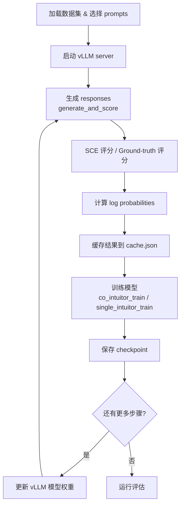

# Co-Learning 详细中文技术文档

---

## 1. 项目概述

**Co-Learning** 是一个 LLM 协同训练框架。其核心思想是：
- 让**两个模型互相学习**（Co-training），或**单模型自训练**（Single-model training）
- 通过 **GRPO/GSPO** 策略梯度方法优化模型
- 使用 **Self-Certainty Estimation (SCE)** 作为无监督奖励信号
- 支持 **多种奖励方法**（majority voting、ground-truth、SCE 加权等）
- 配备 **4 种评估后端**（HACRL / TTRL / LightEval / ZeroEval）

> [!IMPORTANT]
> 这个项目已经**完全移除了对 `trl` 库的依赖**，通过 `utils/trl_compat.py` 提供了独立的替代实现。这使得 `transformers`、`vllm`、`lighteval` 等依赖可以自由升级，不受 trl 版本钉扎的限制。

---

## 2. 核心概念

### 2.1 Self-Certainty Estimation (SCE)

SCE 是本项目的**核心无监督奖励信号**。它通过模型自身的 logits 计算每个 token 的"确定性"分数：

```python
# utils/reward.py — get_per_token_self_certainty()
sce_values = torch.logsumexp(logits, dim=-1) - logits.mean(dim=-1)
```

**原理：** `logsumexp(logits) - mean(logits)` 衡量了 logits 分布的"尖锐程度"。当模型对某个 token 很确定时（概率集中在少数选项上），logsumexp 会远大于 mean，SCE 值就高。

**聚合方式：** 对每个 response 的 SCE 按 completion mask 求均值，得到单个标量的 advantage 分数：
```python
advantage = (SCe * completion_mask).sum(dim=1) / output_lengths
```

### 2.2 GRPO (Group Relative Policy Optimization)

GRPO 是标准的 **token-level** 策略梯度方法：

```
ratio_t = exp(log π_θ(y_t) - log π_old(y_t))       # 每 token 的重要性采样比
clipped_ratio_t = clamp(ratio_t, 1-ε, 1+ε)          # PPO-clip
per_token_loss = -min(ratio_t * A, clipped_ratio_t * A)
loss = mean_over_sequences(mean_over_tokens(per_token_loss * mask))
```

支持三种聚合方式 (`loss_type`)：
| loss_type | 聚合公式 | 说明 |
|-----------|---------|------|
| `grpo` | `mean(Σ(loss * mask) / Σmask)` | 标准 GRPO：每个序列内取平均，再对序列取平均 |
| `bnpo` | `Σ(loss * mask) / Σmask` | 全局 token 平均 |
| `dr_grpo` | `Σ(loss * mask) / (B × max_len)` | 按固定最大长度归一化 |

### 2.3 GSPO (Group Sequence-level Policy Optimization)

GSPO 是 **sequence-level** 的策略梯度方法，核心区别在于使用**代理序列级比率**：

```python
# Surrogate per-token ratio (HACRL 论文的核心公式)
new_mean_logp = mean_over_tokens(log π_θ)
old_mean_logp = mean_over_tokens(log π_old)
neg_approx_kl = sg(new_mean_logp - old_mean_logp)           # stop-gradient
log_ratio_t = log π_θ(y_t) - sg(log π_θ(y_t)) + neg_approx_kl  # 代理比率
```

GSPO 还支持 **mixed-batch 模式**（self + peer 样本混合训练）：
- **Self (J_homo):** 标准 PPO-clip `max(-A*r, -A*clip(r))`
- **Peer (J_hete):** 直接 clipped ratio，带 capability weight 和 IS reweight

### 2.4 奖励方法一览

| 方法 | 类型 | 说明 |
|------|------|------|
| `truth` | 有监督 | Ground-truth 二值奖励 (0/1)，通过 HACRL scorers 评判 |
| `sum_scores` | 无监督 | `w_a * SCE_a + w_b * SCE_b` 交叉模型 SCE |
| `self_scores` | 无监督 | 每个模型只用自己的 SCE 分数 |
| `co_mv` | 无监督 | 联合多数投票（两个模型 2N 个 response 共同投票） |
| `self_mv` | 无监督 | 独立多数投票（每个模型各自在 N 个 response 中投票） |
| `co_wmv` | 无监督 | SCE 加权多数投票 |
| `mv_gated_intuitor` | 混合 | `R = R(MV) × sigmoid(SCE_self)` — MV 提供硬门控 |
| `co_mv_gated_intuitor` | 混合 | `R = R(MV) × sigmoid(SCE_a + SCE_b)` — 交叉 SCE 门控 |

---

## 3. 目录结构详解

```
co-learning/
├── src/                         # 主要源码
│   ├── training/                # 训练入口
│   │   ├── co_intuitor_train.py       # ⭐ 协同训练（A+B 双模型），约 2940 行
│   │   └── single_intuitor_train.py   # ⭐ 单模型训练，约 910 行
│   ├── pipelines/               # 生成/评分/计算流水线
│   │   ├── generate_and_score.py           # Co-model 生成+评分
│   │   ├── generate_and_score_single.py    # 单模型 生成+评分
│   │   ├── generate_and_score_cross.py     # 交叉模型 生成+评分
│   │   ├── generate_only.py               # 仅生成
│   │   ├── score_and_compute.py            # Co-model 评分+logps计算
│   │   └── score_and_compute_single.py     # 单模型 评分+logps
│   └── evaluate_checkpoints.py  # HACRL 评估 CLI（约 5KB）
│
├── eval/                        # 评估后端（统一接口）
│   ├── base.py                  # BaseEvaluator ABC + EvalBackendConfig + EvalResult
│   ├── common/                  # 共享评分原语
│   │   ├── math_equiv.py        # 数学等价性检查
│   │   ├── gsm8k.py             # GSM8K 答案提取
│   │   ├── cruxeval.py          # CRUXEval 数据加载/判定
│   │   ├── code_vs_nl.py        # 代码 vs 自然语言分类
│   │   ├── math_extraction.py   # \boxed{} 答案提取与简化
│   │   └── gt_score.py          # Ground-truth 评分
│   ├── hacrl/                   # HACRL 评估后端
│   │   ├── runner.py            # HACRL 评估运行器
│   │   ├── prime_math.py        # PRIME Math 评分器（约 20KB）
│   │   ├── math_boxed.py        # \boxed{} 数学评分
│   │   ├── math_dapo.py         # DAPO 风格数学评分
│   │   ├── gsm8k.py             # GSM8K 评分
│   │   ├── qa_em.py             # QA 精确匹配评分
│   │   └── timeout.py           # 超时控制
│   ├── ttrl/                    # TTRL 评估后端
│   │   ├── runner.py            # TTRL 评估运行器
│   │   ├── math.py              # TTRL 数学评分（约 24KB，含 sympy 等价判断）
│   │   ├── gsm8k.py             # GSM8K 评分
│   │   └── gpqa.py              # GPQA 评分
│   ├── lighteval/               # LightEval 评估后端
│   │   ├── runner.py            # LightEval 子进程包装器
│   │   ├── custom_tasks/        # 自定义任务定义
│   │   └── datasets/            # 本地数据集构建器
│   └── zeroeval/                # ZeroEval/CRUXEval 后端
│       └── runner.py            # ZeroEval 运行器（约 24KB）
│
├── utils/                       # ⭐ 共享工具库（核心模块）
│   ├── trl_compat.py            # TRL 替代实现（约 430 行）
│   ├── configs.py               # CoIntuitorConfig 配置类（约 530 行）
│   ├── generate.py              # vLLM 生成（约 1130 行）
│   ├── cache.py                 # 缓存系统（约 730 行）
│   ├── reward.py                # 奖励计算与 SCE（约 490 行）
│   ├── mv.py                    # 多数投票/WMV（约 156 行）
│   ├── single_model_trainer.py  # SingleModelTrainer（约 1090 行）
│   ├── tokenization.py          # Tokenization & batch 构建（约 14KB）
│   ├── logps.py                 # Per-token log probability 计算
│   ├── scoring_helpers.py       # 共享 SCE 评分辅助（约 224 行）
│   ├── model_utils.py           # 模型加载辅助
│   ├── prompt_utils.py          # Prompt 渲染
│   ├── normalization.py         # Z-score 归一化
│   ├── dataset.py               # 数据集加载（约 13KB）
│   ├── invariants.py            # 运行时不变量检查（约 11KB）
│   ├── replay_buffer.py         # 回放缓冲区
│   ├── difficulty.py            # 难度估计
│   ├── capability_report.py     # 能力报告
│   ├── distributed_utils.py     # 分布式辅助
│   ├── debug_utils.py           # 调试工具
│   ├── attn.py                  # 注意力实现选择
│   └── env_utils.py             # 环境变量辅助
│
├── scripts/                     # Shell 启动脚本
│   ├── run_co.sh                # ⭐ 协同训练流水线（约 35KB）
│   ├── run_single.sh            # ⭐ 单模型训练流水线（约 24KB）
│   ├── eval.sh                  # 独立评估脚本
│   ├── _lib.sh                  # 共享 shell 函数库（约 17KB）
│   ├── plotting/                # 可视化脚本
│   └── old/                     # 旧版脚本
│
├── recipes/                     # 实验配置
│   ├── configs/                 # JSON 配置文件
│   │   ├── co-q2.5q1.7/        # Qwen2.5 + Qwen1.7 协同训练配置
│   │   ├── co-q2.5q3/          # Qwen2.5 + Qwen3 协同训练配置
│   │   ├── co-q3phi4/          # Qwen3 + Phi4 协同训练配置
│   │   ├── single/             # 单模型训练配置
│   │   ├── eval/               # 评估配置
│   │   └── template/           # 配置模板
│   ├── accelerate_configs/     # Accelerate/DeepSpeed 配置
│   └── datasets.json           # 数据集注册表
│
├── ablation/                    # 消融实验（含测试脚本）
├── third_party/                 # 第三方依赖 (ZeroEval)
├── requirements.txt             # Python 依赖
└── README.md                    # 项目说明
```

---

## 4. 训练流水线

### 4.1 整体训练循环

无论是 co-training 还是 single-model training，训练都遵循一个 **外部循环**（shell 脚本驱动）：



### 4.2 Co-Training（协同训练）

**入口：** `bash scripts/run_co.sh recipes/configs/xxx.json`

**核心思路：** 两个模型 A 和 B 互相学习。每个训练步骤：
1. A 和 B 各自生成 N 个 response（共 2N 个）
2. 两个模型互相评分（SCE 或其他奖励方法）
3. 分别训练 A 和 B，每个模型可以学习自己和/或对方的 response

**关键配置 — `learn_config`：**
```json
{
  "a": {"own": 4, "other": 3},   // 模型 A 学习自己的 4 个 + B 的 3 个 response
  "b": {"own": 4, "other": 3},   // 模型 B 学习自己的 4 个 + A 的 3 个 response
  "selection": "first"            // 选择策略：first / top_score / random
}
```

**训练执行方式：** "Two separate runs" — 每一步分两次独立运行：
```bash
# Run 1: 训练模型 A (policy=A, reward=B)
accelerate launch src/co_intuitor_train.py --train_model a ...
# Run 2: 训练模型 B (policy=B, reward=A)
accelerate launch src/co_intuitor_train.py --train_model b ...
```

> [!NOTE]
> 这种"两次独立运行"的设计避免了 DeepSpeed + Accelerate 多模型冲突的问题。每个训练进程只加载一个模型。

### 4.3 Single-Model Training（单模型训练）

**入口：** `bash scripts/run_single.sh recipes/configs/single_xxx.json`

支持多种奖励模式 (`reward_mode`)：

| 模式 | 说明 |
|------|------|
| `intuitor` | 直接使用 SCE 分数作为 reward |
| `trajectory` | 使用 logprob 作为 reward |
| `truth` | Ground-truth 二值奖励 |
| `wmv` | SCE 加权多数投票 |
| `mv` | 无权重多数投票 |
| `mv_gated_intuitor` | MV × sigmoid(SCE) |

**特性 — DAPO 动态采样 (`filter_groups`)：**
当启用时，过滤掉所有 response 分数相同的 prompt 组（全对或全错），只保留有"混合结果"的组用于训练。这要求 `problems_per_step` > 实际训练 batch size，以便过滤后仍有足够的数据。

### 4.4 SingleModelTrainer

[single_model_trainer.py](file:///e:/Code/co-inference/test/co-learning/utils/single_model_trainer.py) 是实际执行训练的核心类，它：

- **不是** `transformers.Trainer` 的子类，而是一个定制的轻量级训练器
- 直接管理 Accelerator、优化器、调度器
- 支持 DeepSpeed ZeRO-2/3 和 FSDP
- 手动控制梯度累积和优化器步进
- 支持跨步 LR 调度（`total_pipeline_steps`）

**关键实现细节：**
```python
# DeepSpeed 的 backward() 已经处理了梯度累积的 loss 缩放
# 只在非 DeepSpeed 路径下手动缩放
if not self.is_deepspeed_enabled and gradient_accumulation_steps > 1:
    loss = loss / gradient_accumulation_steps

self.accelerator.backward(loss)
```

---

## 5. 评估系统

### 5.1 统一接口

所有评估后端实现 [BaseEvaluator](file:///e:/Code/co-inference/test/co-learning/eval/base.py) 抽象接口：

```python
class BaseEvaluator(ABC):
    @abstractmethod
    def evaluate(self, config: EvalBackendConfig) -> List[EvalResult]:
        """运行评估，返回每个数据集的结果。"""

@dataclass(frozen=True)
class EvalResult:
    dataset: str       # 数据集名称
    accuracy: float    # 准确率
    num_correct: int   # 正确数量
    num_total: int     # 总数
    output_path: str   # 输出路径
    details: dict      # 额外细节
```

### 5.2 四大评估后端

| 后端 | 特点 | 主要用途 |
|------|------|---------|
| **HACRL** | 使用 vLLM 离线推理 + 多种 scorer | MATH-500, GSM8K, AIME 等数学评估 |
| **TTRL** | 三层数学等价判断 (mathd → sympy → latex) | 高精度数学评分，支持 GPQA |
| **LightEval** | HuggingFace 官方评估框架 | 通用评估任务 |
| **ZeroEval** | ZeroEval 仓库集成 | CRUXEval (代码评估) |

**配置方式（JSON）：**
```json
{
  "eval": {
    "hacrl":    { "enabled": true, "datasets": "math_500,gsm8k", ... },
    "ttrl":     { "enabled": false, ... },
    "lighteval": { "enabled": true, "tasks": "...", ... },
    "zeroeval":  { "enabled": true, ... }
  }
}
```

### 5.3 数学答案提取与判等

答案提取链路：
1. **`extract_answer()`** — 从 response 中提取 `\boxed{}` 中的最终答案
2. **`simplify_expression_string()`** — 使用 sympy 将答案化简为标准形式
3. **`grade()`** (TTRL) — 三层判等：
   - `grade_answer_mathd` — MATH dataset 风格的字符串比较
   - `grade_answer_sympy` — sympy 符号计算等价判断
   - `is_latex_equal` — LaTeX 表达式等价判断

---

## 6. 核心工具模块详解

### 6.1 vLLM 生成 ([generate.py](file:///e:/Code/co-inference/test/co-learning/utils/generate.py))

支持两种后端：
- **HTTP API** (`generate_responses`)：通过 vLLM OpenAI 兼容服务器生成
- **Offline API** (`generate_sequences`)：HACRL 风格的离线推理

**关键特性：**
- 自动启动/停止 vLLM 服务器管理
- 空生成自动重试（最多 3 次）
- Prompt echo 清理（避免 vLLM 回显 prompt）
- Chat template 标记清理
- 支持 sleep/wake 模式节省 GPU 内存
- `trust_remote_code` 文件自动修补

**重要辅助函数：**
```python
strip_prompt_echo(prompt, text)                      # 去除 prompt 回显前缀
strip_chat_template_artifacts(text)                  # 清理 ChatML/Llama 特殊标记
strip_prompt_echo_from_flattened_responses(...)       # 批量处理
strip_chat_template_artifacts_from_flattened_responses(...)
```

### 6.2 缓存系统 ([cache.py](file:///e:/Code/co-inference/test/co-learning/utils/cache.py))

**设计要点：**
- 缓存只保存**最新 step** 的数据（覆盖式写入，不累积）
- 两个文件：`cache.json`（生成+分数）和 `logps_cache.json`（log probabilities）
- 只有 rank-0 写入磁盘，其他 rank 通过 `_load_cache()` 读取
- 使用 tmp 文件 + `os.replace()` 实现原子写入

**缓存结构：**
```
cache.json:
├── generations_a:  {step, total_unique_prompts, text_responses, prompts, finish_reasons}
├── generations_b:  {step, total_unique_prompts, text_responses, prompts, finish_reasons}
├── scores_a:       {step, advantages}
├── scores_b:       {step, advantages}
├── checkpoint_info: {step, start_index, sampled_indices, epoch, etc.}
└── 历史记录（追加式）:
    ├── mean_rewards_history
    ├── mean_sc_scores_history
    ├── reward_stats_history
    └── capability_ratio_history

logps_cache.json:
├── logps_a:        {step, old_per_token_logps, ref_per_token_logps, alignment, logits_to_keep}
├── logps_b:        {step, old_per_token_logps, ref_per_token_logps, ...}
├── cross_logps_a:  {step, old_per_token_logps, ...}  # A 的 logps on B 的 responses
└── cross_logps_b:  {step, old_per_token_logps, ...}  # B 的 logps on A 的 responses
```

### 6.3 Majority Voting ([mv.py](file:///e:/Code/co-inference/test/co-learning/utils/mv.py))

实现了两种多数投票：

**Weighted Majority Voting (WMV):**
1. 提取每个 response 的 `\boxed{}` 答案
2. 使用 sympy 简化答案为标准形式
3. 按简化后的字符串分组，累加 SCE 权重
4. 选择权重最大的组的答案作为 pseudo-label
5. 判断每个 response 是否与 pseudo-label 数学等价 → 0/1 奖励

**Unweighted MV:** 等价于所有权重为 1.0 的 WMV。

### 6.4 TRL 兼容层 ([trl_compat.py](file:///e:/Code/co-inference/test/co-learning/utils/trl_compat.py))

提供了以下 `trl` 库功能的独立实现，**无需安装 trl**：

| 原 trl 接口 | 替代实现 | 说明 |
|-------------|---------|------|
| `trl.trainer.utils.selective_log_softmax` | `selective_log_softmax()` | 内存高效的 log_softmax → gather |
| `trl.trainer.utils.pad` | `pad()` | 张量列表填充对齐 |
| `trl.data_utils.maybe_apply_chat_template` | `maybe_apply_chat_template()` | Chat template 渲染 |
| `trl.models.unwrap_model_for_generation` | `unwrap_model_for_generation()` | DeepSpeed ZeRO-3 参数收集 |
| `trl.ModelConfig` | `ModelConfig` | 模型配置 dataclass |
| `trl.ScriptArguments` | `ScriptArguments` | 脚本参数 dataclass |
| `trl.TrlParser` | `TrlParser` | 命令行 + YAML 解析 |
| `trl.get_quantization_config` | `get_quantization_config()` | BitsAndBytes 量化配置 |
| `trl.get_kbit_device_map` | `get_kbit_device_map()` | 量化模型 device map |

**`selective_log_softmax` 关键实现：**
```python
# 对 float32/float64 使用高效的 logsumexp 实现
selected_logits = torch.gather(logits, dim=-1, index=index)
logsumexp_values = torch.stack([torch.logsumexp(lg, dim=-1) for lg in logits])
per_token_logps = selected_logits - logsumexp_values.unsqueeze(-1)

# 对其他精度（bf16 等）逐行 log_softmax 避免精度问题
for row_logits, row_labels in zip(logits, index):
    row_logps = F.log_softmax(row_logits, dim=-1)
    row_per_token_logps = row_logps.gather(dim=-1, index=row_labels)
```

### 6.5 配置系统 ([configs.py](file:///e:/Code/co-inference/test/co-learning/utils/configs.py))

**`CoIntuitorConfig`** 继承自 `transformers.TrainingArguments`，增加了大量参数：

#### GRPO 核心参数
| 参数 | 默认值 | 说明 |
|------|--------|------|
| `num_generations` | 8 | 每个 prompt 采样的 response 数量 |
| `max_completion_length` | 2048 | 最大 completion 长度 (tokens) |
| `max_prompt_length` | None | 最大 prompt 长度，None=不截断 |
| `temperature` | 1.0 | 采样温度 |
| `epsilon` | 0.2 | PPO-clip 下界 ε |
| `epsilon_high` | None | PPO-clip 上界，默认等于 epsilon |
| `beta` | 0.0 | KL 惩罚系数，0.0 = 不需要参考模型 |
| `num_iterations` | 1 | 每 batch 的优化迭代次数 (μ in GRPO) |
| `loss_type` | "grpo" | 损失类型：grpo / bnpo / dr_grpo |
| `scale_rewards` | True | 是否按组标准差归一化奖励 |
| `objective_mode` | "grpo" | 策略目标：grpo (token-level) / gspo (sequence-level) |

#### Co-Training 特有参数
| 参数 | 默认值 | 说明 |
|------|--------|------|
| `num_generations_per_model` | 4 | 每个模型每个 prompt 的 response 数 |
| `reward_method` | "sum_scores" | 奖励方法（见 §2.4） |
| `reward_weight_a/b` | 1.0 | SCE 分数权重 |
| `co_update_mode` | "mixed" | 数据消费模式：mixed / two_phase |
| `learn_config` | None | Per-model 学习配置 JSON |
| `selected_indices_a/b` | None | 自定义训练索引 |
| `capability_weight_mode` | "sc_ratio" | 能力比率计算方式 |
| `capability_ratio_smoothing` | "latest" | 平滑方式：latest / last_k |
| `stable_perf` | 0 | 前 N 步强制 capability weight = 1.0 |

#### GSPO 特有参数
| 参数 | 默认值 | 说明 |
|------|--------|------|
| `is_length_norm` | "mean" | 序列级 IS 的长度归一化：mean / sqrt_len / none |
| `gspo_surrogate_ratio_enabled` | True | 是否使用 GSPO 代理比率 |
| `self_update_epsilon_low/high` | None | 自我更新的独立 ε 参数 |
| `peer_special_clip_asymmetric_enabled` | False | 非对称 clip（ratio ≤ 1.0） |
| `peer_special_clip_stepwise_enabled` | False | 逐步收紧 clip |
| `peer_is_reweight_enabled` | False | 非梯度指数重权 |
| `peer_loss_uniform` | False | Peer loss 使用与 self 相同的 PPO-clip |

#### 跨步 LR 调度
| 参数 | 默认值 | 说明 |
|------|--------|------|
| `total_pipeline_steps` | 0 | 外部流水线总步数（0=禁用） |
| `current_pipeline_step` | 0 | 当前流水线步骤 |

> [!TIP]
> 通过 `total_pipeline_steps` + `current_pipeline_step` 可以实现**跨多次调用的学习率 warmup 和 cosine decay**。每次 shell 脚本调用训练时传入当前步数，调度器会自动前进到正确位置。

---

## 7. 流水线模块 (src/pipelines/)

### 7.1 generate_and_score.py (Co-Training)

1. 读取数据集，选择本 step 的 prompts（支持顺序/随机采样）
2. 启动 vLLM 服务器 A 和 B
3. 模型 A 生成 N 个 response，模型 B 生成 N 个 response
4. 根据 `reward_method` 计算奖励/分数
5. 计算 old logps（用于 IS ratio）
6. 保存到 cache

### 7.2 generate_and_score_single.py (Single-Model)

同上，但只有一个模型。

### 7.3 score_and_compute.py

专门用于**仅评分和计算 logps**（当生成已完成或从其他来源获取时）。

---

## 8. 关键技术细节

### 8.1 Prompt Padding 语义

> [!WARNING]
> **Prompt 必须 LEFT-pad！** 这是为了与 `build_left_padded_prompt_completion_batch`（logps 计算时使用）保持一致。Right-padding prompts 会导致 RoPE position_ids 偏移，使训练时的 logps 与缓存的 old/ref logps 不一致。

### 8.2 EOS 追加策略

```python
# 仅在 completion 未被截断时追加 EOS
if is_truncated is False:
    completion_id = append_eos_1d(cid, eos_token_id=eos_id)
elif is_truncated is True:
    pass  # 不追加 EOS
else:
    # 没有 finish_reason 时的启发式：如果长度 < max_completion_length，追加 EOS
    if max_completion_length is None or len(cid) < max_completion_length:
        completion_id = append_eos_1d(cid, eos_token_id=eos_id)
```

**之后还会截断到第一个 EOS（包含）：**
```python
if eos_id in completion_list:
    first_eos = completion_list.index(eos_id)
    completion_id = completion_id[:first_eos + 1]
```

### 8.3 KL 散度计算

使用 HACRL 的 k3 估计器（forward KL），带数值安全的 clamp：
```python
delta_kl = ref_logps - logps                           # ref - current
delta_kl = clamp(delta_kl, min=-20, max=20)            # 防止 exp 溢出
per_token_kl = clamp(exp(delta_kl) - delta_kl - 1,     # k3 estimator
                     min=-10, max=10)
```

### 8.4 Capability Weight (能力比率)

GSPO co-training 中的核心概念，用于调节 peer 样本的影响力：

```
w(k, j) = R̄_k / R̄_j    # k 是被训练模型，j 是样本来源模型
```

- 分母和分子都有 floor = 1e-8
- 最终 clamp 到 [0.1, 10.0]
- 支持滑动窗口平滑 (`last_k`, 默认 K=5)
- 前 `stable_perf` 步强制 w = 1.0

### 8.5 DeepSpeed 集成注意事项

1. **DeepSpeed 启用时不设置 `device_map` 和 `quantization_config`** — DeepSpeed/Accelerate 自动处理设备放置
2. **DeepSpeed 的 `backward()` 已包含 gradient_accumulation 缩放** — 不要手动再除以 GAS
3. **模型保存时所有 rank 必须参与** — ZeRO-3 的 `get_state_dict()` 使用 all_gather
4. **优化器使用 `foreach=False`** — 减少 ZeRO-3 下的峰值内存

---

## 9. 环境变量参考

| 变量 | 默认值 | 说明 |
|------|--------|------|
| `CO_ASSERT_INVARIANTS` | `1` | 启用运行时不变量检查 |
| `CO_DEBUG_NAN` | `0` | 启用 NaN 调试，dump 到 `CO_DEBUG_NAN_DIR` |
| `CO_DEBUG_NAN_RAISE` | `1` | NaN 时是否 raise 异常 |
| `CO_DEBUG_DATA` | `0` | 启用训练数据调试 dump |
| `CO_DEBUG_TRAIN_BOUNDARY` | `0` | 调试梯度累积边界 |
| `CO_DEBUG_DS_STEPS` | `0` | 调试 DeepSpeed 步计数 |
| `CO_MASK_PAD_BEFORE_EXP` | `0` | 在 exp() 前遮盖 padding（兼容旧缓存） |
| `CO_EMPTY_CACHE_EVERY_STEP` | `0` | 每步清空 CUDA 缓存 |
| `CO_EMPTY_CACHE_ON_BOUNDARY` | `0` | 在累积边界清空 CUDA 缓存 |
| `CO_EMPTY_CACHE_LOGPS` | `0` | logps 计算前清空 CUDA 缓存 |
| `CO_ADAMW_FOREACH` | None | 控制 AdamW 的 foreach 参数 |
| `CO_VLLM_STRIP_PROMPT_ECHO` | `1` | 是否清理 vLLM 回显 |
| `CO_PIPELINE_TRUTHCHECK` | `0` | 流水线数据格式检查 |
| `VLLM_MAX_MODEL_LEN` | — | 限制 vLLM 上下文长度 |
| `VLLM_MAX_NUM_SEQS` | — | 限制 vLLM 并发序列数 |

---

## 10. 数据集注册表

[datasets.json](file:///e:/Code/co-inference/test/co-learning/recipes/datasets.json) 定义了所有支持的数据集。每个数据集指定：

```json
{
  "math_500": {
    "dataset_name": "...",           // HF 路径或本地路径
    "dataset_config": "default",      // 配置名
    "prompt_column": "problem",       // 提示列名
    "answer_column": "solution",      // 答案列名
    "split": "test",                  // 数据集划分
    "instruction_suffix": "..."       // 可选的指令后缀
  }
}
```

目前支持的数据集包括：
- **数学：** MATH-500, GSM8K, MATH-lighteval, AIME24, AIME25, AMC23
- **代码：** CRUXEval
- **通用：** GPQA (TTT 格式)
- **分级：** MATH-L1 到 MATH-L5 (按难度分级)

---

## 11. 运行指南

### 11.1 环境配置

```bash
pip install -r requirements.txt
```

> [!NOTE]
> 依赖版本约束：
> - Python ≥ 3.10
> - PyTorch ≥ 2.4.0
> - transformers ≥ 4.56.0, < 5.0.0 (vLLM 要求)
> - vLLM ≥ 0.17.0
> - datasets ≥ 4.0.0
> - lighteval ≥ 0.13.0
> - **不需要 trl！**

### 11.2 单模型训练

```bash
bash scripts/run_single.sh recipes/configs/single/single_intuitor_gspo.json
```

### 11.3 协同训练

```bash
bash scripts/run_co.sh recipes/configs/co-q2.5q1.7/co_intuitor_hacpo.json
```

### 11.4 独立评估

```bash
# 使用配置文件运行所有启用的评估后端
bash scripts/eval.sh recipes/configs/eval/eval.json --model_path /path/to/checkpoint

# 单独运行 HACRL 评估
python -m src.evaluate_checkpoints --model_path /path/to/model --datasets math_500,gsm8k

# 单独运行 TTRL 评估
python -m eval.ttrl.runner --model_path /path/to/model

# 单独运行 LightEval
python -m eval.lighteval.runner --model_path /path/to/model

# 单独运行 ZeroEval/CRUXEval
python -m eval.zeroeval.runner --model_path /path/to/model
```

---

## 12. 消融实验 (ablation/)

`ablation/` 目录包含多个测试脚本用于验证和调试各个组件：

| 文件 | 用途 |
|------|------|
| `test_mv_gated_reward.py` | 测试 MV-gated-intuitor 奖励计算 |
| `test_replay_buffer.py` | 测试回放缓冲区 |
| `test_difficulty_estimation.py` | 测试难度估计 |
| `test_max_tokens_extraction.py` | 测试 max_tokens 提取 |
| `test_ttrl_eval.py` | 测试 TTRL 评估 |
| `test_system_prompts.sh` | 测试 system prompt 消融 |
| `run_prompt_mode_ablation.sh` | Prompt 模式消融 |
| `run_batch_ttrl_eval.sh` | 批量 TTRL 评估 |
| `plot_correctness_map.py` | 绘制正确性热力图 |

---

## 13. 架构决策总结

1. **移除 trl 依赖** → 通过 `trl_compat.py` 独立实现，解决版本冲突
2. **"Two separate runs" 协同训练** → 避免 DeepSpeed 多模型冲突
3. **缓存驱动的流水线** → 生成/评分/训练解耦，可独立重跑任何阶段
4. **统一评估接口** → 4 个后端通过 `BaseEvaluator` ABC 统一，配置化启用/禁用
5. **vLLM 推理 + HF 训练** → 生成阶段使用 vLLM 高效推理，训练阶段使用 HF transformers
6. **Left-pad prompt + Right-pad completion** → 保证 RoPE position 一致性
7. **广泛的调试基础设施** → NaN dump、数据 dump、不变量检查、boundary 调试

---

## 14. 补充工具模块详解

### 14.1 Tokenization ([tokenization.py](file:///e:/Code/co-inference/test/co-learning/utils/tokenization.py))

提供了与 open-r1-intuitor 对齐的 tokenization 语义，核心功能：

| 函数 | 说明 |
|------|------|
| `append_eos_1d()` | 在 1D token ID 张量末尾追加 EOS |
| `pad_sequence_to_length()` | 2D 张量 padding 到指定长度（支持左/右 pad） |
| `postprocess_data()` | 对 tokenizer 输出做 padding/truncation 后处理（支持 left/right/middle 截断） |
| `tokenize_and_postprocess_data()` | 一步完成 tokenize + postprocess（HACRL 风格） |
| `get_response_mask()` | 生成 EOS-inclusive response mask：EOS 及之前为 1，之后为 0 |
| `build_left_padded_prompt_completion_batch()` | **核心函数** — 构建 Flash-Attn 安全的 left-padded batch |

**`build_left_padded_prompt_completion_batch` 设计要点：**
- 确保 `attention_mask` 是纯 left-padding（`0...01...1`），无 right-padding holes
- Completion padding 位置的 `attention_mask` 设为 1（Flash-Attn 安全），但通过 `completion_mask_window` 在 loss 中忽略
- 自动处理 EOS 追加/截断逻辑，与 vLLM 生成行为对齐

### 14.2 Log Probability 计算 ([logps.py](file:///e:/Code/co-inference/test/co-learning/utils/logps.py))

两层 API 设计：

- **`get_per_token_logps()`** — 底层核心，支持 micro-batch 处理和温度缩放：
  ```python
  logits = model(input_ids, attention_mask, logits_to_keep=L+1).logits
  logits = logits[:, :-1, :]        # 排除最后一个 logit
  logits = logits[:, -L:]           # 只保留 completion 窗口
  logps = selective_log_softmax(logits, input_ids[:, -L:])
  ```
  注意：**不 detach**，因为训练时需要梯度。

- **`compute_per_token_logps_from_prebuilt_batch()`** — 高层分布式包装器，自动加载模型、分片数据、gather 结果。用 `@torch.no_grad()` 装饰。

### 14.3 数据集加载 ([dataset.py](file:///e:/Code/co-inference/test/co-learning/utils/dataset.py))

- 自动检测本地目录中的 parquet/json/jsonl 文件
- 按文件名/父目录名自动推断 train/test/validation split
- 支持 HF 风格 `data/` 子目录布局
- 自动追加 instruction suffix（按数据集族匹配：math → `\boxed{}`，gsm8k → `####`）
- 将原始 prompt 转为 chat message 列表 `[{"role":"system",...},{"role":"user",...}]`

### 14.4 归一化 ([normalization.py](file:///e:/Code/co-inference/test/co-learning/utils/normalization.py))

两种归一化方法：

- **`z_score_normalize_tensor()`** — Z-score 归一化到 N(μ=5.0, σ=1.0)，clip 到 [μ-3σ, μ+3σ]。用于 `co_wmv` 中将 A/B 两模型的 SCE 分数对齐到同一尺度。
- **`normalize_to_unit_interval()`** — Z-score + sigmoid 压缩到 [0,1]。用于 capability ratio 的 SCE 归一化。

### 14.5 难度估计 ([difficulty.py](file:///e:/Code/co-inference/test/co-learning/utils/difficulty.py))

> [!NOTE]
> **仅提供接口，未默认接入训练循环。**

支持两种估计方法：
- **MV 法** (`estimate_difficulty_mv`)：difficulty = 1 - MV 一致率。答案越一致 → 越简单。
- **SCE 法** (`estimate_difficulty_intuitor`)：difficulty = 1 - normalized(mean_SCE)。SCE 越高（模型越自信）→ 越简单。

均匀分桶：按 difficulty 排序后均分为 N 个 bucket（默认 3：easy/medium/hard）。

### 14.6 回放缓冲区 ([replay_buffer.py](file:///e:/Code/co-inference/test/co-learning/utils/replay_buffer.py))

> [!NOTE]
> **仅提供接口，未默认接入训练循环。**

- 持久化的 JSON 回放缓冲区，保存"突破性"轨迹（首次正确解答困难题目）
- FIFO 淘汰策略，默认容量 10000
- `hard_threshold=0.8`：只有 difficulty ≥ 0.8（solve rate < 20%）的正确解答才入缓冲
- `mix_replay_into_batch()` — 将 batch 中指定比例（默认 10%）替换为缓冲区样本

### 14.7 运行时不变量检查 ([invariants.py](file:///e:/Code/co-inference/test/co-learning/utils/invariants.py))

由 `CO_ASSERT_INVARIANTS=1` 和 `CO_PIPELINE_TRUTHCHECK=1` 分别控制的断言系统：

| 检查函数 | 验证内容 |
|----------|----------|
| `assert_prompt_completion_shapes()` | prompt/completion 张量必须 2D，batch 维度一致，mask 形状匹配 |
| `assert_attention_mask_matches_concat()` | attention_mask 必须等于 cat(prompt_mask, completion_mask) |
| `tc_check_padding_semantics()` | Prompt mask 非递减（left-pad），completion mask 非递增（right-pad） |
| `tc_check_generations_block()` | 验证 responses 数量 = prompts × num_generations |
| `tc_check_score_vector()` | 验证分数向量长度可被 num_prompts 整除 |
| `tc_check_training_batch()` | 验证完整训练 batch 的所有张量形状与类型 |
| `tc_check_hacpo_mixed_batch()` | 验证 HACPO mixed batch 的 model_source、capability_weight 有效性 |

### 14.8 调试工具 ([debug_utils.py](file:///e:/Code/co-inference/test/co-learning/utils/debug_utils.py))

所有函数受 `CO_DEBUG_DATA=1` 守护，生产环境无开销：

- `co_dump_alignment_samples()` — dump prompt+completion+padding 的对齐样本到 JSONL
- `co_dump_single_logps_samples()` — dump logps/token 对齐验证数据
- `co_append_jsonl()` — best-effort JSONL 追加写入

### 14.9 Prompt 渲染 ([prompt_utils.py](file:///e:/Code/co-inference/test/co-learning/utils/prompt_utils.py))

- `render_prompt()` — 对有 chat_template 的 tokenizer 使用 `apply_chat_template`，否则 fallback 到纯文本拼接
- 默认 `enable_thinking=False`（与 HACRL 的 RL 训练模式对齐）
- 支持 `enable_thinking=None`（不传参数，匹配 TTRL 行为）
- 对 problem dict 执行 deep copy 防止 in-place 修改

---

## 15. JSON 配置模板说明

配置文件位于 `recipes/configs/template/`，提供了三种模板：

| 模板 | 适用脚本 | 说明 |
|------|---------|------|
| `_template_co.json` | `run_co.sh` | 双模型协同训练 |
| `_template_single.json` | `run_single.sh` | 单模型训练 |
| `_template_cross.json` | `run_cross.sh` | 交叉模型训练 |

配置文件为 JSON 格式，以 `_` 前缀的 key 为文档注释（如 `"_method": "说明..."`）。

**Co-Training 配置结构：**
```
{
  "name": "运行名称",
  "models": { "model_a": "...", "model_b": "..." },
  "dataset": {
    "key": "数据集 key",
    "problems_per_step": 128,
    "system_prompt": "...",
    "prompt_mode": null,          // system | suffix | bare
    "enable_thinking": "false"    // false | true | none
  },
  "generation": {
    "num_generations_per_model": 4,
    "temperature": 1.0,
    "max_completion_length": 2048
  },
  "scoring": { "scoring_batch_size": 4, "logps_batch_size": 16 },
  "reward": { "method": "...", "scorer": "...", "beta": 0.0005 },
  "training": {
    "num_gpus": 2,
    "max_steps": 10,
    "learning_rate": "3e-6",
    "objective_mode": "gspo",
    "co_update_mode": "two_phase",
    "capability_ratio_smoothing": "last_k",
    "learn_config": null
  },
  "vllm": { "port_a": 8004, "port_b": 8005, "gpu_a": 0, "gpu_b": 1 },
  "output": { "checkpoint_dir": "..." },
  "eval": {
    "lighteval": { "enabled": true, ... },
    "zeroeval":  { "enabled": false, ... },
    "hacrl":     { "enabled": false, ... },
    "ttrl":      { "enabled": false, ... }
  }
}
```

**已有实验配置：**
| 目录 | 模型组合 |
|------|----------|
| `co-q2.5q1.7/` | Qwen2.5 + Qwen1.7 |
| `co-q2.5q3/` | Qwen2.5 + Qwen3 |
| `co-q3phi4/` | Qwen3 + Phi4 |
| `co-q1.5q1.7/` | Qwen1.5 + Qwen1.7 |
| `co-q1.7q3/` | Qwen1.7 + Qwen3 |
| `co-q2.5phi4/` | Qwen2.5 + Phi4 |
| `single/` | 各种单模型配置 |

---

## 16. Shell 脚本库 ([_lib.sh](file:///e:/Code/co-inference/test/co-learning/scripts/_lib.sh))

所有 shell 脚本共享的核心函数库（466 行），提供：

### 16.1 环境静默
自动设置 20+ 个环境变量抑制 DeepSpeed / NCCL / transformers 等库的冗余日志。

### 16.2 JSON 配置加载
```bash
_load_config "config.json"    # 将嵌套 JSON 展平为 bash 关联数组
cfg "section.key" "default"   # 读取配置值
cfg_json "section"            # 读取嵌套对象为 JSON 字符串
```

### 16.3 vLLM 生命周期管理
| 函数 | 说明 |
|------|------|
| `_start_vllm_server()` | 启动 vLLM 服务器（含 kill 旧进程、端口释放、健康检查、模型加载等待） |
| `_vllm_kill_port()` | 按端口 kill vLLM 进程（SIGTERM → SIGKILL 升级） |
| `_vllm_wait_health()` | 轮询 `/health` 端点直到 200（超时 600s） |
| `_vllm_wait_port_free()` | 等待端口释放 |

### 16.4 评估后端调用
| 函数 | 说明 |
|------|------|
| `run_lighteval()` | 调用 `eval.lighteval.runner`，带 done marker 防重复 |
| `run_zeroeval()` | 调用 `eval.zeroeval.runner` |
| `run_hacrl_eval()` | 调用 `src.evaluate_checkpoints`，支持离线/在线 vLLM |
| `run_ttrl_eval()` | 调用 `eval.ttrl.runner` |

### 16.5 其他工具
- `prune_old_checkpoints()` — 删除 checkpoint 目录下除最新外的所有旧 checkpoint
- `setup_debug()` — 初始化调试环境变量（NaN dump、数据 dump）
- `_eval_compat()` — 旧配置格式兼容层
